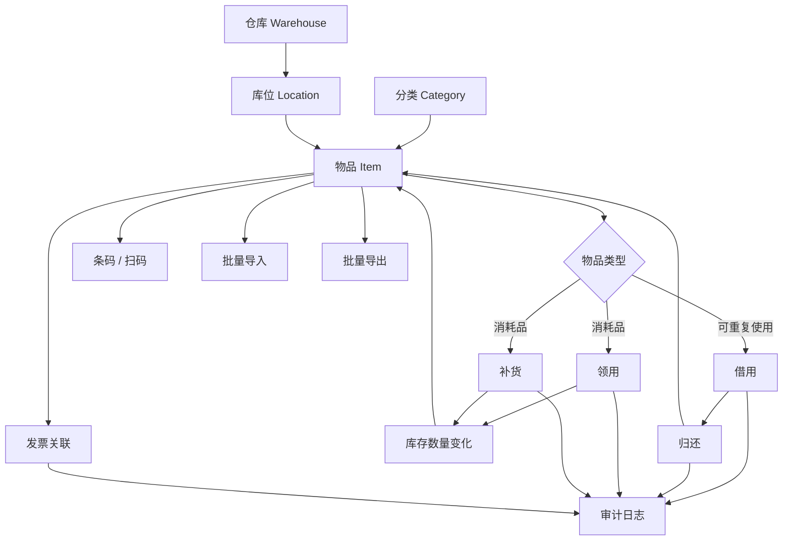
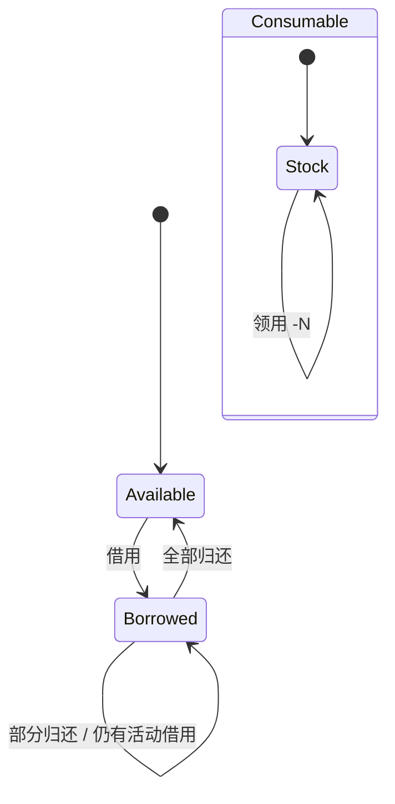
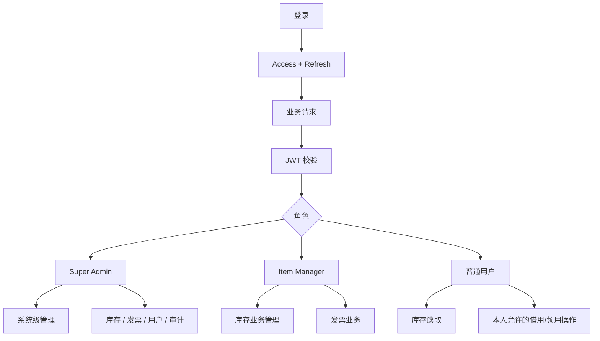
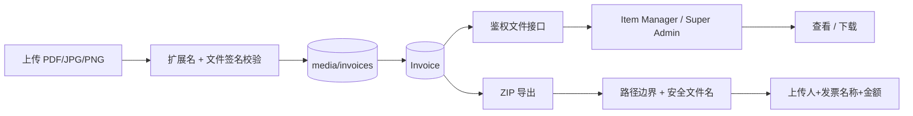
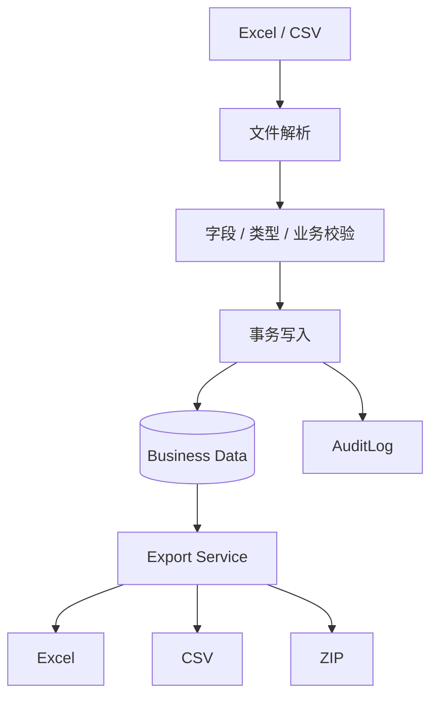
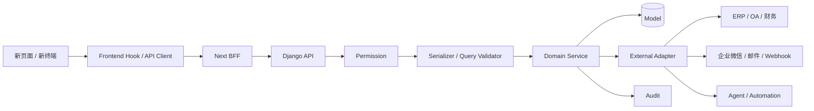

# LightWMS 轻量级仓库管理系统

[](https://opensource.org/licenses/MIT)
[](https://www.python.org/)
[](https://nodejs.org/)
[](https://www.docker.com/)

LightWMS 是一个面向轻量化仓库管理场景的 Web WMS，当前覆盖物品、仓库、库位、分类、借还、领用补货、条码扫码、发票、用户权限、审计日志、导入导出和系统设置。

> 本 README 只把“已经实现的能力”和“规划中的扩展方向”分开描述。详细系统调用链、事务边界和代码审计状态见 [docs/SYSTEM_LOGIC.md](docs/SYSTEM_LOGIC.md) 与 [docs/CODE_AUDIT.md](docs/CODE_AUDIT.md)。

## 系统逻辑框架

```mermaid
flowchart LR
    U[浏览器 / 手机 / PDA] --> N[Next.js Frontend]
    N --> MW[Middleware 页面登录门禁]
    N --> AUTHBFF[/api/auth/*\nHttpOnly Cookie BFF]
    N --> WMSBFF[/api/wms/*\n业务 API BFF]
    N --> MEDIA[/api/media/*\n公开媒体代理]

    AUTHBFF --> D[Django REST API]
    WMSBFF -->|Bearer Access Token| D
    MEDIA --> D

    D --> JWT[JWT Authentication]
    JWT --> RBAC[RBAC / Permission Scope]
    RBAC --> VIEW[View / Serializer\n输入与查询校验]
    VIEW --> SERVICE[Service Layer\n事务与业务不变量]

    SERVICE --> PG[(PostgreSQL\n业务事实源)]
    SERVICE --> REDIS[(Redis\n缓存 / 限流)]
    SERVICE --> FS[(Media Volume\n图片 / 发票文件)]
    SERVICE --> AUDIT[(Audit / Login Logs)]
```

### 核心设计原则

1. **浏览器不直接保存 JS 可读 JWT**：access/refresh token 使用 HttpOnly Cookie。
2. **Next.js 是浏览器 BFF**：负责 Cookie、同源访问和代理；Django 才是最终业务权限边界。
3. **前端隐藏按钮不是安全控制**：所有角色权限必须由 Django Permission / Query Scope 再校验。
4. **Service 层负责业务一致性**：写操作应统一处理事务、行锁、状态转换、审计和文件副作用。
5. **PostgreSQL 是业务事实来源**：Redis 只承担缓存、限流等辅助职责。
6. **发票属于私有文件**：不能通过公开 `/media/invoices/*` 绕过鉴权直接读取。
7. **高风险操作必须可审计**：密码、角色、库存、借还、发票、系统设置等修改均要考虑 AuditLog。
8. **业务闭环优先于单页面功能**：任何新增功能都需要同时检查 API、权限、事务、数据库、前端契约和测试。

## 核心业务闭环



### 物品状态与数量



库存写操作的目标不是“接口返回成功”即可，而是同时保证：数量不能越界、状态不能矛盾、并发不能丢更新、业务记录与 Item 状态一致、失败时不能出现半提交。

## 用户、认证与权限框架



| 操作 | Super Admin | Item Manager | 普通用户 |
|---|---:|---:|---:|
| 修改自己的密码 | 是 | 是 | 是 |
| 修改/重置他人密码 | 是 | 否 | 否 |
| 用户角色、启停、删除 | 是 | 否 | 否 |
| 库存业务管理 | 是 | 是 | 按接口授权 |
| 发票业务 | 是 | 是 | 否 |
| 查看审计日志 | 是 | 否 | 否 |
| 修改系统设置 | 是 | 否 | 否 |

密码、角色、账号状态发生安全敏感变化时，需要同步处理旧会话失效，而不是只修改数据库字段。

## 发票与文件安全链路



发票附件与普通物品图片采用不同安全级别：普通图片可以通过媒体代理展示，发票必须经过登录与角色权限检查。

## 导入、导出与审计



导入导出重点防止：部分提交、重复记录、非法主键、公式注入、路径穿越和越权导出。

## 当前已实现功能

### 仓库与库存

- 仓库、库位、分类管理
- 物品新增、修改、停用、删除
- 可重复使用物品与消耗品
- 物品图片及主图
- 条码生成、扫码查询
- 条件筛选与搜索
- 批量库位/负责人等管理操作

### 出入库与使用记录

- 借用、归还
- 数量型借用
- 领用、补货
- 借用记录、领用记录、补货记录
- 库存状态与业务流水关联

### 发票

- PDF/JPG/PNG 发票上传
- 发票与物品关联
- 上传者、日期、状态等筛选
- ZIP 批量导出
- 报销清单 Excel 导出
- 导出文件名按“上传人+发票名称+发票金额”生成

### 用户与权限

- Super Admin / Item Manager / 普通用户
- 邀请码注册
- 登录与 JWT 会话
- 修改密码、管理员设置/重置密码
- 用户启停、角色修改、删除/历史安全归档

### 运维与安全

- AuditLog / LoginLog
- PostgreSQL + Redis 健康检查
- 系统 Logo / 主题设置
- Docker Compose 部署
- PostgreSQL + media 备份恢复
- DockerHub 版本检查
- CI：后端测试、前端类型/构建、Docker smoke test

## 功能扩展框架

后续扩展遵守一个原则：**新增能力不直接塞进巨型 `views.py` 或页面组件，而是沿“路由 -> 权限 -> 校验 -> Service -> Model/外部适配器 -> 审计 -> 前端 Hook/UI -> 测试”扩展。**



### 建议的扩展优先级

以下属于**规划候选，不代表当前已经实现**：

| 优先级 | 扩展方向 | 目标 |
|---|---|---|
| P1 | 盘点任务 | 生成盘点单、扫码盘点、差异确认、盘盈盘亏审计 |
| P1 | 调拨 | 仓库/库位之间调拨，保证出库与入库同一事务语义 |
| P1 | 库存预警 | 最低库存、安全库存、缺货提醒 |
| P1 | 统计报表 | 库存总量、借用率、领用量、补货量、库存周转、发票金额 |
| P2 | 审批流 | 借用、领用、调拨、报废、采购等按金额/角色进入审批 |
| P2 | 报废/损耗 | 报废原因、照片、责任人、审计和库存扣减 |
| P2 | PDA 专用模式 | 面向手机/PDA 的连续扫码、快速借还、盘点、调拨 |
| P2 | 通知中心 | 逾期、低库存、审批、异常操作通知 |
| P2 | Webhook/API | 为第三方 ERP、OA、财务系统提供稳定集成边界 |
| P3 | 插件机制 | 独立扩展统计、同步、自动化功能，减少修改核心代码 |
| P3 | Agent 自动化 | 在权限和审计约束下进行库存查询、报表、异常巡检等自动化 |
| P3 | SSO/OIDC | 企业统一身份认证；真实微信认证应作为 Provider Adapter 接入 |
| P3 | 多组织/多租户 | 在确有需求时增加组织级数据隔离，不直接复用 owner 字段代替租户边界 |

### 扩展模块的最低验收条件

任何新增模块进入主分支前至少需要：

1. 明确角色权限矩阵；
2. Serializer / Query 参数严格校验；
3. 写操作明确事务范围和并发锁策略；
4. 数据库约束与 Service 不变量一致；
5. 关键操作写入审计；
6. 文件操作处理提交/回滚生命周期；
7. 前后端 API 类型与错误契约一致；
8. 正常、非法输入、越权、边界、并发测试；
9. 后端测试、前端 build/typecheck、Docker smoke 全部通过；
10. 更新 README、`SYSTEM_LOGIC.md` 和 `CODE_AUDIT.md`。

## DockerHub 快速部署

当前默认部署方式是 **本地/局域网 IP + 端口直接访问**：

```text
浏览器 -> http://NAS或主机IP:3000 -> Next.js frontend -> Docker 内网 backend:8000
```

默认部署 **不启动 Nginx、不映射容器 80 端口、不把浏览器重定向到其他端口**。API 和上传文件都由前端同源转发，因此浏览器只需要访问一个端口。

```bash
# 1. 克隆仓库
git clone https://github.com/liheng-lk/lightwms.git
cd lightwms

# 2. 创建环境变量
cp docker/.env.example .env
# 必须修改 SECRET_KEY 和 POSTGRES_PASSWORD

# 3. 推荐固定正式版本
# .env 中设置：LIGHTWMS_VERSION=1.2.1

# 4. 启动
docker compose -f docker/compose/docker-compose.dockerhub.yml pull
docker compose -f docker/compose/docker-compose.dockerhub.yml up -d

# 5. 创建管理员
docker compose -f docker/compose/docker-compose.dockerhub.yml exec backend python manage.py createsuperuser
```

局域网访问示例：

```text
http://192.168.1.20:3000
```

如果希望改端口，只修改 `.env`：

```text
HTTP_PORT=18080
```

然后访问：

```text
http://192.168.1.20:18080
```

## HTTP / HTTPS Cookie

本地 IP+端口默认是 HTTP，因此：

```text
SECURE_COOKIES=false
```

只有在浏览器实际通过 HTTPS 访问时才设置：

```text
SECURE_COOKIES=true
```

## Docker 镜像

| 服务 | 正式版本 | 最新版本 |
|---|---|---|
| Backend | `liheng6668/lightwms-backend:1.2.1` | `liheng6668/lightwms-backend:latest` |
| Frontend | `liheng6668/lightwms-frontend:1.2.1` | `liheng6668/lightwms-frontend:latest` |

生产环境建议固定 `LIGHTWMS_VERSION=1.2.1`，确认升级后再切换版本。

## 生产安全

- 发票附件属于私有业务文件，不能通过公开 `/media/invoices/*` 直接读取；管理人员查看发票时会经过登录和角色权限校验。
- 发票上传不仅检查扩展名和大小，还校验 PDF/JPG/PNG 的文件签名，降低伪装文件上传风险。
- 删除存在业务历史的用户时保留外键历史，但会禁用账户、失效令牌并匿名化不再需要的个人信息。
- `/api/v1/health/` 同时检查 PostgreSQL 和缓存依赖，关键依赖异常时返回 503，供 Docker 健康检查使用。
- 数据库与上传文件应一起备份。备份与恢复说明见 [BACKUP_RESTORE.md](BACKUP_RESTORE.md)。

## 技术栈

| 类型 | 技术 |
|---|---|
| 前端 | Next.js 16, React 19, TypeScript |
| 后端 | Django 4.2, Django REST Framework |
| 数据库 | PostgreSQL 15 |
| 缓存 | Redis 7 |
| 部署 | Docker Compose |

详细部署说明见 [DEPLOYMENT.md](DEPLOYMENT.md)。

## 代码审计与发布门禁

当前采用分阶段审计：

1. Auth / JWT / User / RBAC
2. Inventory 主数据
3. Borrow / Return
4. Take / Replenish
5. Invoice / private files
6. Import / Export
7. Audit / Settings
8. Frontend BFF / UI contract
9. Docker / Backup / Restore / Release
10. Full regression / edge / concurrency

详细问题、状态、修复 PR 和验证结果统一记录在 [docs/CODE_AUDIT.md](docs/CODE_AUDIT.md)。

发布前必须确认：后端测试、前端 typecheck/build、Docker smoke test 均真实执行并通过；GitHub Actions 若出现未启动任何 step、无日志的基础设施失败，不得误判为代码通过或代码失败。

## 安全

- 修改默认 `SECRET_KEY` 和 PostgreSQL 密码
- 不公开固定管理员密码或邀请码
- 互联网暴露时使用 HTTPS
- HTTPS 部署时设置 `SECURE_COOKIES=true`
- 定期备份 PostgreSQL 与上传文件，并执行恢复演练

## License

MIT License
