# LightWMS 系统逻辑框架

> 本文档用于代码审计与后续维护。目标不是描述页面，而是明确每一条业务请求经过哪些权限边界、校验层、事务和数据副作用。

## 1. 总体架构

```mermaid
flowchart LR
    U[浏览器用户] -->|HTTP/HTTPS :3000| N[Next.js Frontend]
    N --> M[Next Middleware\n页面登录门禁]
    N --> A[/api/auth/*\nHttpOnly Cookie BFF]
    N --> W[/api/wms/*\n业务 API 代理]
    N --> PM[/api/media/*\n公开媒体代理]

    A -->|登录/刷新/退出| D[Django REST API :8000]
    W -->|Bearer Access Token| D
    PM -->|仅公开媒体| D

    D --> AUTH[Custom JWT Authentication]
    AUTH --> RBAC[DRF Permission / Role Scope]
    RBAC --> V[View / Query Validation]
    V --> S[Service / transaction.atomic]
    S --> DB[(PostgreSQL)]
    S --> R[(Redis Cache)]
    S --> FS[(media volume)]
    S --> AUD[(Audit / Login Logs)]

    D --> INVFILE[Authenticated Invoice File API]
    INVFILE --> FS
```

### 核心边界

1. 浏览器不直接持有 JS 可读 JWT；access/refresh token 存在 HttpOnly Cookie。
2. Next.js BFF 从 Cookie 读取 token，再以 Authorization Bearer 转给 Django。
3. Django 是最终权限边界；前端隐藏按钮只用于体验，不能替代后端权限。
4. PostgreSQL 是业务事实来源；Redis 只承担缓存/限流，不应成为唯一业务数据源。
5. `media` 中普通图片可公开，发票附件必须经过鉴权接口读取。
6. 所有安全敏感操作必须同时考虑数据库状态、JWT 会话、审计日志和磁盘文件副作用。

## 2. 登录与 JWT 生命周期

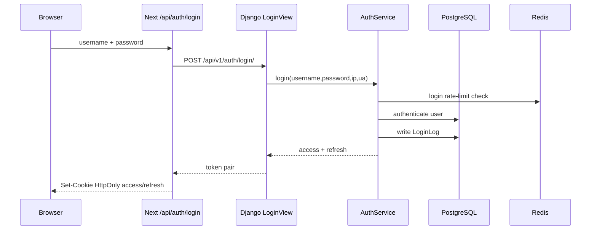

### 访问业务接口

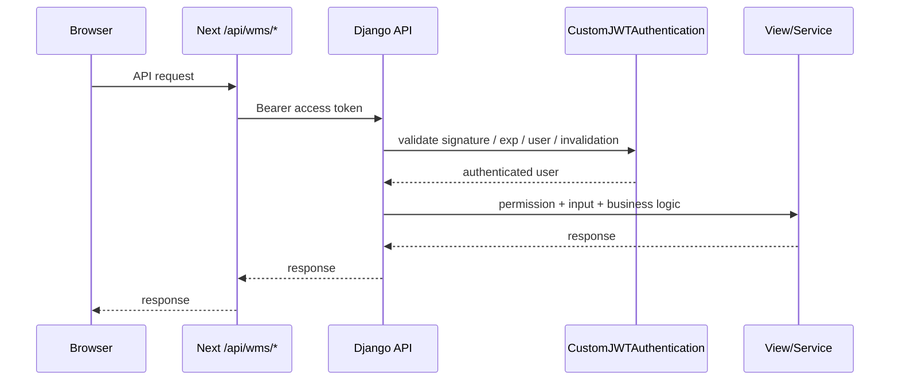

### Access 过期后的刷新

当前后端 refresh token 是**一次性消费并旋转**：旧 refresh 成功刷新后立即进入 blacklist，不能再次使用。因此前端并发刷新必须与这一事实保持一致，不能假定 refresh 是幂等操作。

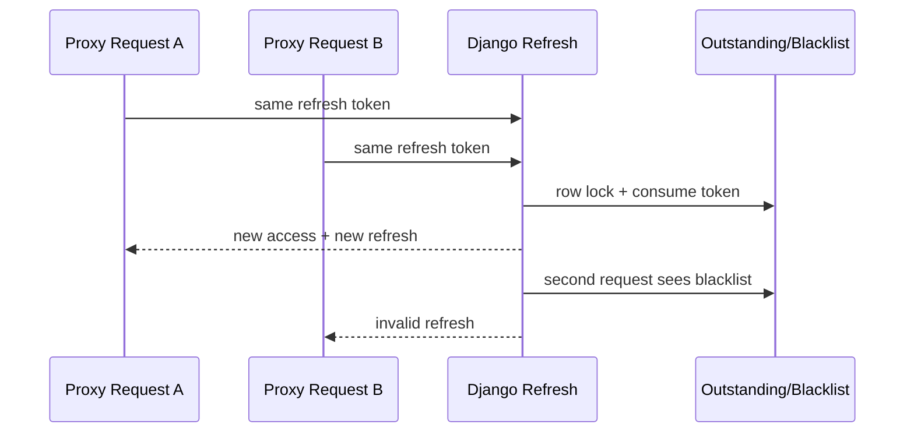

这条并发链是当前重点审计项，必须避免成功请求与失败请求互相覆盖浏览器 Cookie 状态。

## 3. 密码修改与管理员密码操作

```mermaid
flowchart TD
    LOGIN[已登录用户] --> SELF[POST /users/me/change-password]
    SELF --> IA[IsAuthenticated]
    IA --> OLD[校验当前密码]
    OLD --> STRONG[Django password validators]
    STRONG --> TX[事务锁定当前 User]
    TX --> SAVE[set_password + clear must_change_password]
    SAVE --> INVALID[使旧会话失效]
    INVALID --> AUDIT[写 UPDATE AuditLog]
    AUDIT --> RELOGIN[前端清 Cookie并要求新密码重新登录]

    ADMIN[Super Admin] --> OTHER[/users/id/set-password or reset-password]
    OTHER --> SA[IsSuperAdmin]
    SA --> TARGET[锁定目标用户]
    TARGET --> SAVE2[设置/重置密码]
    SAVE2 --> INVALID2[目标用户旧会话失效]
    INVALID2 --> AUDIT2[审计]
```

权限规则：

| 操作 | Super Admin | Item Manager | 普通用户 |
|---|---:|---:|---:|
| 修改自己的密码 | 是 | 是 | 是 |
| 修改他人密码 | 是 | 否 | 否 |
| 重置他人临时密码 | 是 | 否 | 否 |
| 修改角色 | 是（不能改自己） | 否 | 否 |
| 启用/禁用用户 | 是（不能禁用自己） | 否 | 否 |
| 删除用户 | 是（不能删除自己） | 否 | 否 |

## 4. 用户注册与邀请码

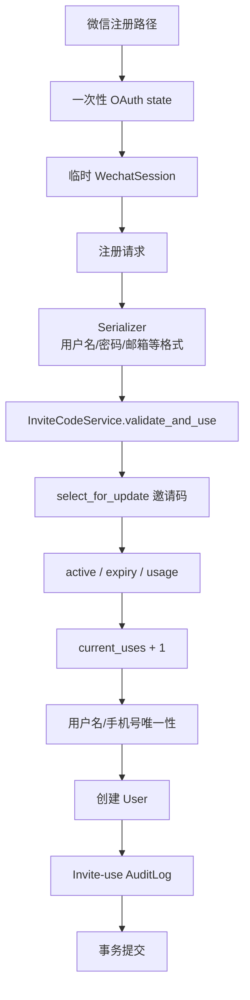

注意：当前微信 provider exchange 仍是 mock 实现，不能把它当成真实微信身份认证能力。

## 5. 角色与业务权限总图

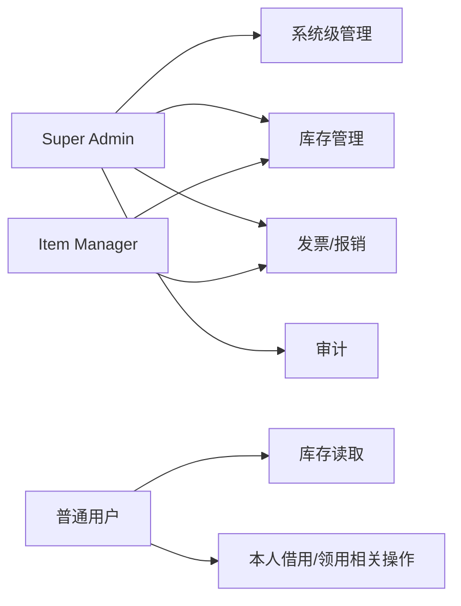

关键原则：`Item.owner` 是责任/元数据，不应被无意当成全局角色授权的唯一依据；具体接口若需要 owner scope，必须在查询层明确实现并有测试。

## 6. 库存主数据逻辑

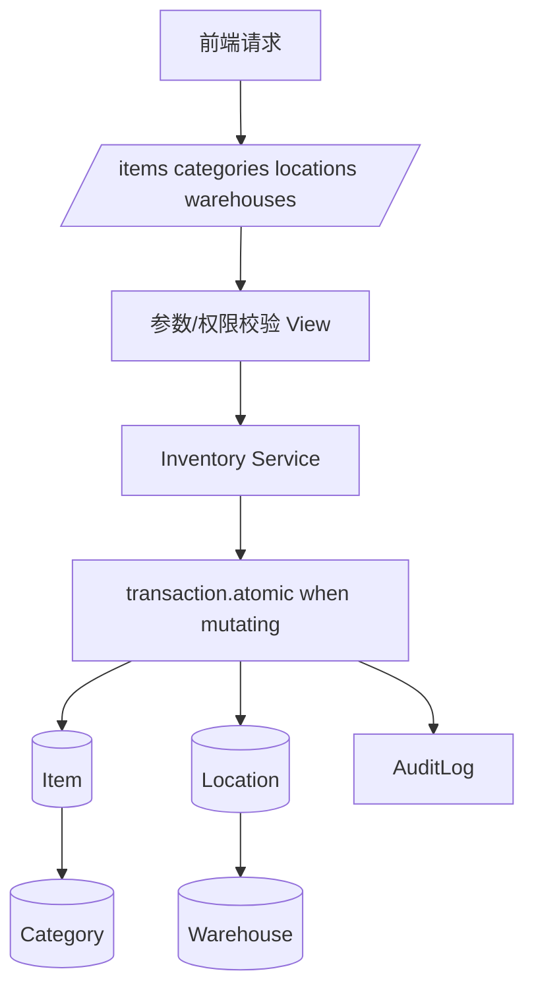

审计重点：
- 新旧 `views.py` 与 `validated/permission/atomic` wrapper 是否存在绕过路径。
- quantity/status/type 之间是否有数据库与 service 双层不变量。
- 删除/停用主数据时历史业务 FK 是否安全。
- list/search/scan/detail 的权限和 borrower 隐私是否一致。

## 7. 借用 / 归还

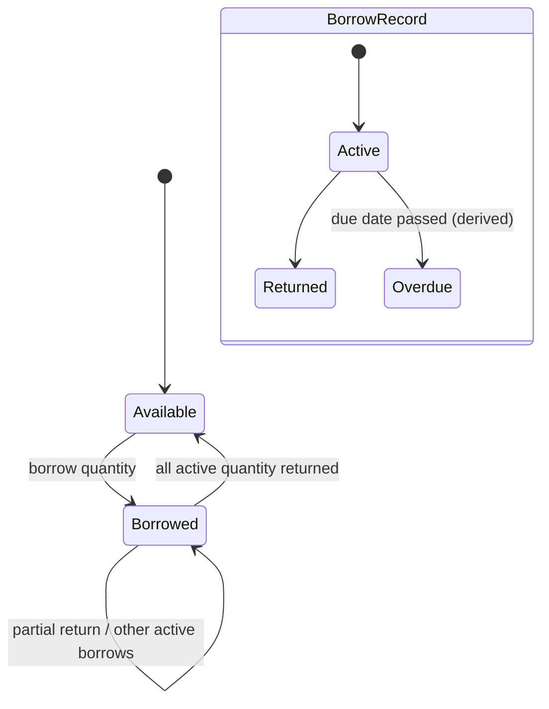

写操作必须核对：
- item 类型是否允许借用；
- 可借数量是否足够；
- 并发请求是否锁行；
- return quantity 不超过 active borrowed quantity；
- Item quantity 与 BorrowRecord 汇总不矛盾；
- 操作失败时 audit / DB 不出现半提交。

## 8. 领用 / 补货

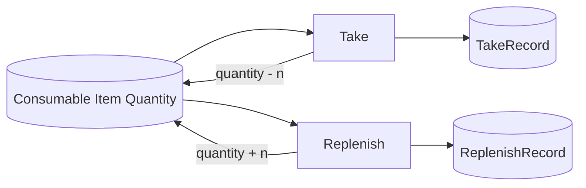

重点检查负库存、整数边界、并发丢失更新、ledger 与 item 数量原子一致性。

## 9. 发票生命周期

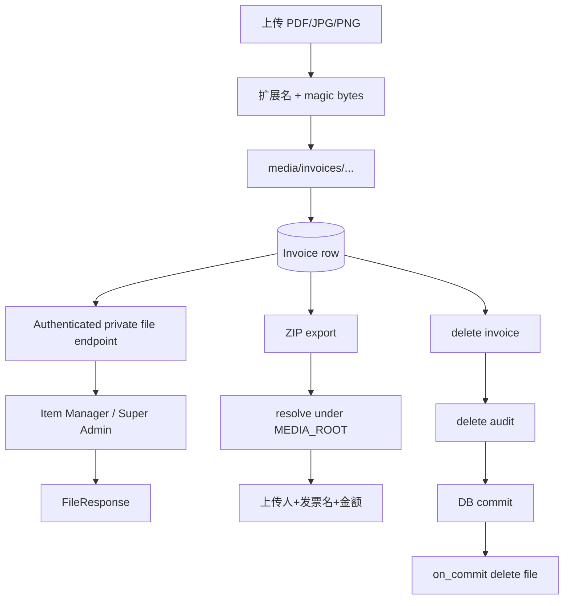

公开 `/media/*` 必须拒绝 `invoices/` 前缀。

## 10. 导入 / 导出

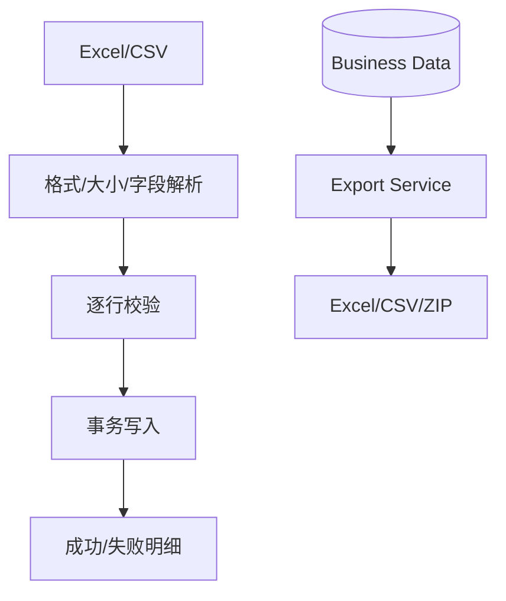

审计重点是公式注入、文件内容伪装、重复主键、部分导入、错误行导致的事务语义和导出数据权限。

## 11. 审计日志

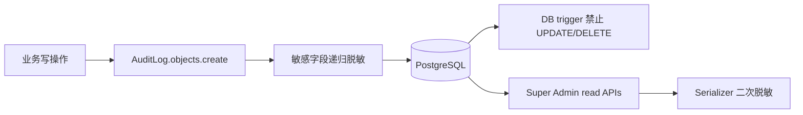

## 12. 设置 / Logo

系统设置写入只允许 Super Admin。远程 Logo URL、本地图片/SVG 必须经过 URL、真实格式、SVG 活动内容、路径边界和事务文件生命周期校验。

## 13. 备份 / 恢复

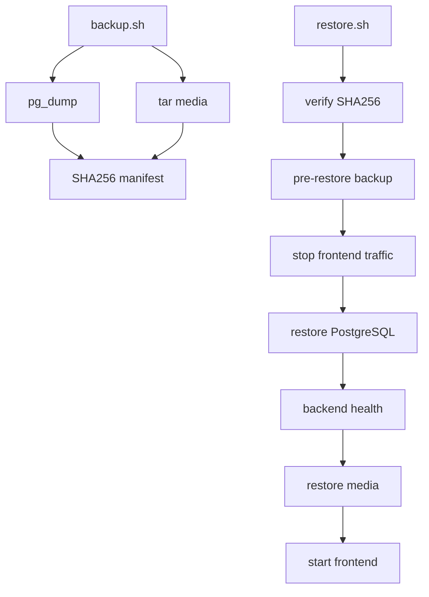

## 14. 发布链

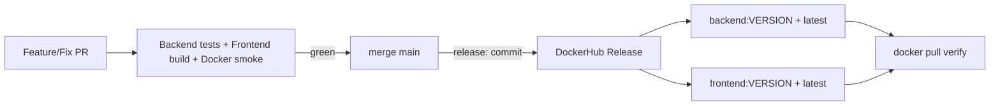

## 15. 代码审计顺序

1. 认证 / 用户 / JWT / RBAC
2. Inventory 主数据与查询
3. 借用 / 归还
4. 领用 / 补货
5. 发票 / 私有文件 / 导出
6. Import / Export
7. Audit / Settings
8. Frontend API BFF / React Query / 页面权限契约
9. Docker / Compose / Backup / Restore / Release
10. 全量边界与并发回归

每一阶段必须满足：发现可复现 -> 加失败测试 -> 最小修复 -> 全模块回归 -> CI/Docker 验证，才标记完成。
